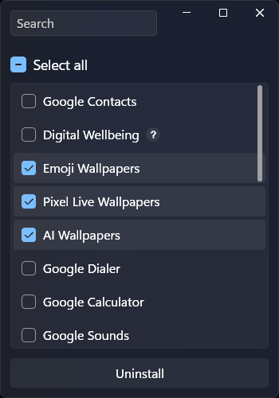
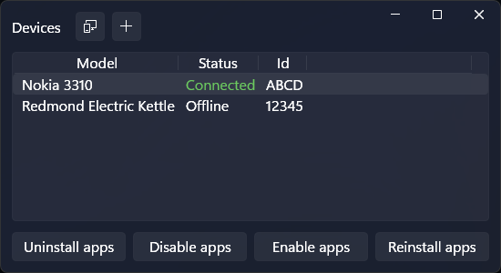

# ADB Debloater

<!-- markdownlint-disable-next-line MD036 -->
**A PowerShell tool to debloat Android devices with ADB**

## Screenshots

### Package select dialog

  <picture>
    <source media="(prefers-color-scheme: light)" srcset="assets/screenshots/packages_light.png">
    
  </picture>

### Device select dialog

  <picture>
    <source media="(prefers-color-scheme: light)" srcset="assets/screenshots/devices_light.png">
    
  </picture>

## Features

- Options to: uninstall, disable, enable and reinstall apps
- Curated bloatware list from vendors like Google, Samsung, Xiaomi, and others
- WPF GUI in the WinUI 3 style
- Localized interface, app names and tooltips
- Automatic ADB downloading if it is not found in the PATH

## Usage

1. Launch PowerShell in any terminal
2. Download this repo:

   ```powershell
   iwr 'https://codeload.github.com/SunsetTechuila/ADB-Debloater/zip/refs/heads/master' -useb -out 'ADB-Debloater.zip'; expand-archive 'ADB-Debloater.zip'; cd 'ADB-Debloater'; mv */* ./
   ```

3. Enable debugging on your mobile device<sup>[`ℹ️`](https://developer.android.com/tools/adb#Enabling)</sup>
4. Connect your mobile device to your PC
5. Run the script:

   ```cmd
   ./start
   ```

Next time you can run the script by double clicking the "start" file in the "ADB-Debloater" folder.

## Requirements

- Windows 10 or higher
- PowerShell 5.1 or higher


